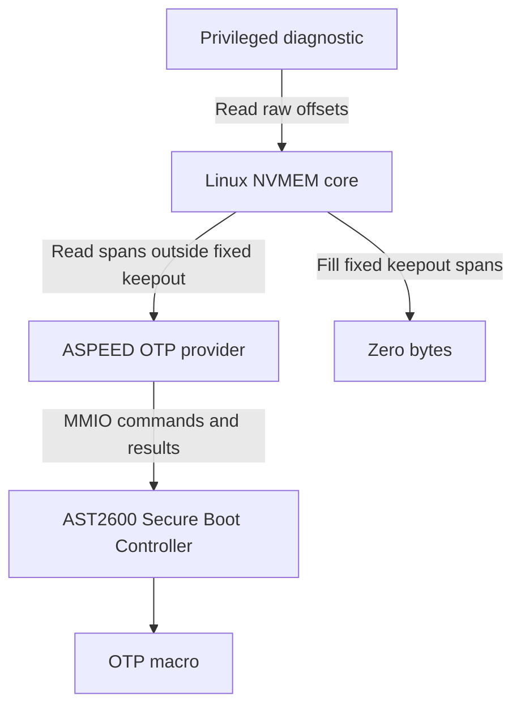
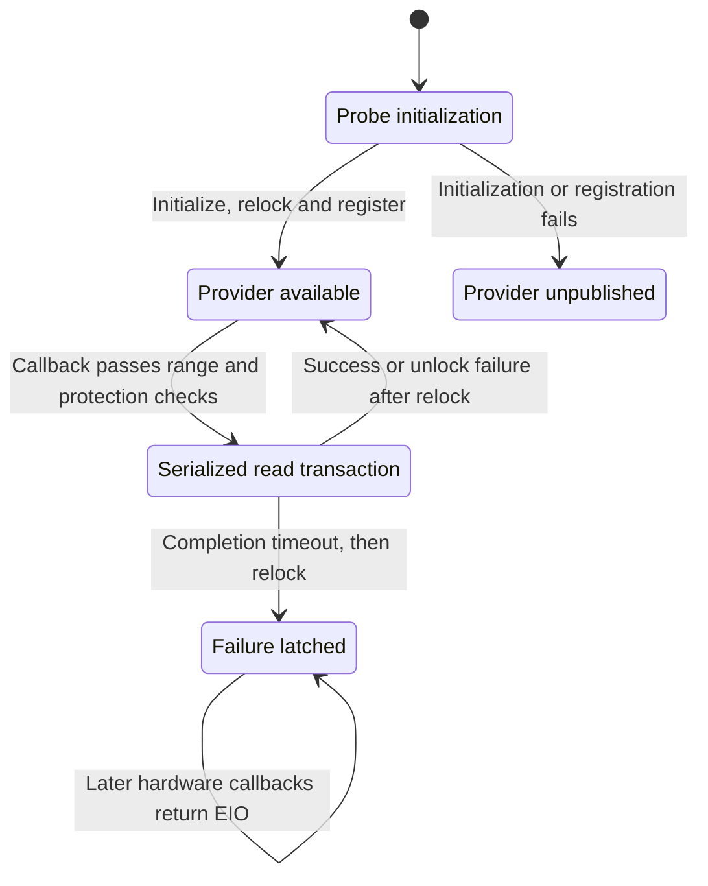
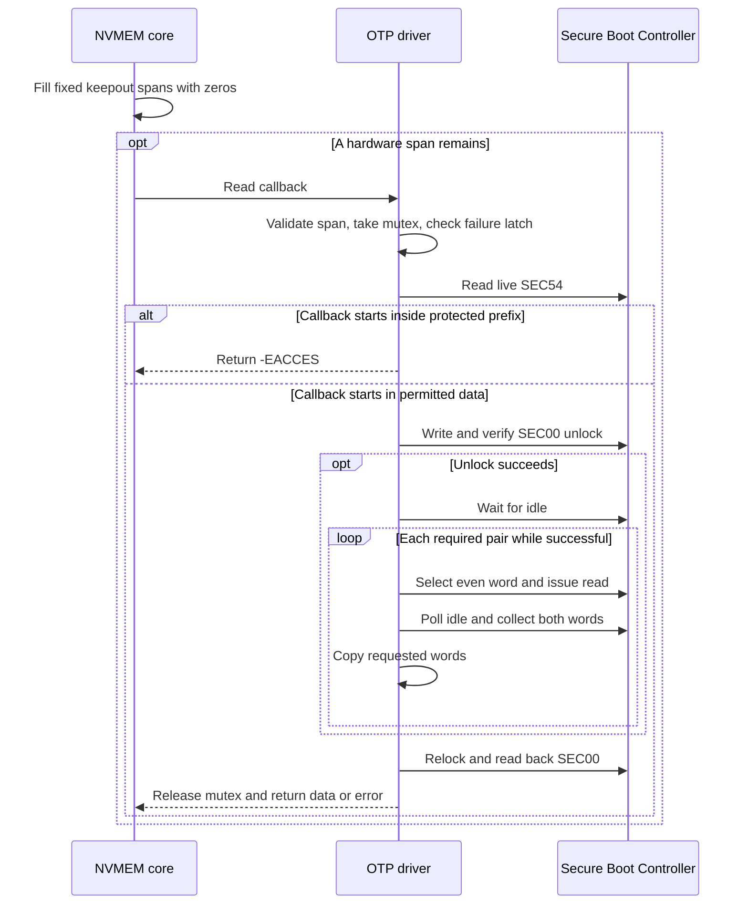

# ASPEED AST2600 read-only OTP NVMEM driver

## Problem and requirements

During BMC bring-up on the ASRock Rack B650D4U, privileged userspace diagnostics need to read raw AST2600 OTP offsets and compare the bytes with a saved ASPEED-derived reference. The diagnostic workflow uses no named NVMEM cells. The hardware validation compares a 12-byte range at offsets 8172–8183.

The driver exposes the 8-KiB OTP data window through Linux NVMEM. It restricts raw userspace access to root, provides no fuse-programming operation, and applies the fixed and live protection boundaries before issuing data reads. Concurrent callers share one controller, so the driver serializes transactions and stops issuing commands through the affected instance after a completion timeout.

## Interface and architecture

| Interface | Contract |
| --- | --- |
| Source | `drivers/nvmem/nvmem-aspeed-otp.c` |
| Build | `CONFIG_NVMEM_ASPEED_OTP`, module `nvmem-aspeed-otp` |
| Device Tree compatible | `aspeed,ast2600-sbc` |
| Platform driver and provider base name | `aspeed-otp`. NVMEM assigns a device ID. |
| Userspace access | Root-only, read-only NVMEM file. Configuration memory is internal to the driver. |
| Provider read granularity | Four-byte word size and stride. The callback requires a word-aligned offset and length within the data window. |
| Returned bytes | Little-endian word layout. The destination buffer may be unaligned. |

### Resource ownership

The platform device supplies the SBC MMIO resource. Each driver instance owns its mapping, mutex, fixed keepout and failure flag. The NVMEM core owns the userspace interface and fills fixed keepout spans. The driver owns the command sequence and checks live protection before each hardware read callback.

The mutex serializes callers of this provider because SEC04, the address register and the result registers are shared across commands. Its scope runs from the runtime protection check through relock and the write-completion readback. It provides no coordination with firmware or other MMIO writers.

## Controller lifecycle diagram

The state diagram describes the **driver instance**. The command gate and the physical command engine have separate states. Opening SEC00 enables submission through SEC04. Closing it blocks new command writes but does not abort a command already running.

Probe runs before provider registration, so there are no NVMEM callbacks to serialize. After opening and verifying the command gate, the driver waits for idle and restores read mode. Earlier firmware may leave the macro in programming mode. The mode command writes volatile settings at the named MRA, MRB and MR macro addresses. Those addresses are selected through the controller address register. The operation does not program fuse cells.

Probe then reads the pair containing CONF0 and derives the fixed keepout from the first returned word. Configuration words serve internal policy and are outside the exported data window. Probe issues a relock write even if unlock verification or initialization fails. It has no relock readback because there is no runtime mutex handoff. An initialization error prevents provider registration.

## Read transaction sequence

The hardware reads pairs starting at an even word index. For an odd starting word, the driver selects the preceding even word and copies only the second result. It advances to the next pair as needed. When the last requested word is the first word of a pair, it copies only that word. Unaligned-safe little-endian stores preserve the byte layout independently of output-buffer alignment.

Register offsets, masks, command values and macro addresses have named definitions. The driver uses direct MMIO accesses to preserve the order of controller operations.

## Protection policy

The fixed boundary comes from the CONF0 secure-size field. A nonzero boundary registers a keepout starting at zero with a zero filler. The NVMEM core supplies filler without asking the controller to read those bytes.

SEC54[5:0] can grow until the ARM cores reset. The driver samples it once per hardware read callback while holding the mutex. The effective protected prefix ends at `max(CONF0 secure-size field, SEC54[5:0]) × 128 bytes`. The check uses the start of the callback span because protection covers a prefix. Both boundaries are multiples of the eight-byte pair size, so aligning down a permitted starting word stays outside the protected prefix.

| Condition | Caller-visible behavior |
| --- | --- |
| Bytes lie in the fixed keepout | The NVMEM core supplies zeros. A request entirely within the keepout needs no driver callback. |
| A hardware callback starts in the additional protected prefix | The callback returns `-EACCES` before unlocking or issuing a read command for that span. |
| SEC14[8] is set | Programming protection alone does not prohibit reads and is not used as a read gate. |

The live-range check is a snapshot at callback entry. The provider mutex does not freeze SEC54 or synchronize changes made by other agents during a multi-pair read.

## Completion and failure handling

The controller reports idle through both bits in SEC14[2:1]. The driver starts sampling after an initial delay of at least 1 µs, then uses one bounded polling sequence per wait. The 100-ms bound is an engineering limit per wait. ASPEED's clarification does not establish a 100-ms hardware maximum.

| Condition | Driver action |
| --- | --- |
| Empty callback or invalid span | Return success for zero length. Return `-EINVAL` for a nonempty span with invalid alignment or bounds. |
| SEC00 unlock readback differs from the expected value | Return `-EIO` and issue a relock write. This path does not set the timeout latch. |
| Completion wait expires | Log the sampled status, latch failure and return `-ETIMEDOUT`. Issue the relock write on exit. |
| Later hardware callback sees the failure latch | Return `-EIO` before reading SEC54 or submitting commands. Fixed keepout-only requests can still be served by the core. |

Runtime relock includes an SEC00 readback to complete the write before releasing the mutex. The driver discards the returned value. The readback establishes write completion for the handoff and supplies no lock-state verification.

A timeout leaves the physical command state uncertain. The software failure flag prevents future commands through the same driver instance. It does not reset the controller or provide a recovery procedure. ASPEED provided no documented safe retry sequence.

Rebinding creates a new driver instance and clears its software failure flag; it does not establish that the physical controller has safely recovered.

## Design decisions

| Requirement | Decision and rationale |
| --- | --- |
| Give bring-up diagnostics a standard raw-read interface | Use a root-only, read-only NVMEM provider over the data window. This gives the diagnostic its required offset access while keeping fuse programming and configuration memory outside the interface. |
| Represent fixed and changing protection | Register a fixed keepout for CONF0 and check SEC54 on each hardware callback. This preserves the core's zero-fill behavior and rejects additional protected hardware spans using the current sampled range. |
| Make shared register transactions coherent | Hold one mutex over the runtime transaction. Another provider caller cannot change the selected address before the first caller collects the data. |
| Start reads in the expected macro mode | Restore read mode once at probe. This removes dependence on the mode left by earlier firmware without writing fuses. |
| Keep command cleanup consistent | Share unlock and relock helpers. Inner helpers do the work while submission is enabled, and outer helpers own relock and runtime mutex lifetime. |
| Bound failures when command state is uncertain | Bound each idle wait and latch timeouts so the driver does not submit another command against a potentially busy controller. |

## Validation

The submitter's serial-console record dated 21 November 2026 reports exit status 0 on an ASRock Rack B650D4U with AST2600 A3. The board TFTP RAM-booted upstream-based Linux `7.4.0-rc1-68da063-patch-ccbf460-otp-v3` using the working OpenBMC DTB and initramfs. The recorded base is `6628e7d4c6b25c8d18f1345e3a20d21829aae7e4`. The provider was `/sys/bus/nvmem/devices/aspeed-otp7/nvmem`.

| Check | Result |
| --- | --- |
| Repeated 12-byte reads | Matching results |
| Cross-pair read | Matched three individual word reads |
| Final pair | Matched its individual word reads |
| Concurrent reads | Four readers completed ten matching reads each |
| Bytes 8172–8183 | Matched the saved ASPEED-derived reader fingerprint |

The fingerprint is a saved reader reference. The record contains no independent provisioning comparison. The read script did not induce hardware protection or a controller stall. The RAM boot validates the tested kernel read path. Full OpenBMC userspace validation is outside this run.

### Build, binding, and software checks

| Check | Recorded result |
| --- | --- |
| ARM kernel build and FIT packaging | The submitter completed the `W=1` build and generated the FIT used for the RAM-boot hardware test. |
| SBC binding | `dt_binding_check` exited 0 with `DT_SCHEMA_FILES=arm/aspeed/aspeed,sbc.yaml`. The run used isolated dtschema 2026.4 with a workspace-local diagnostic lookup fix. All validation rules remained enabled. The run reported zero SBC diagnostics and two unrelated TI type diagnostics. |
| Binding controls | The valid SBC example passed, and the unknown-property negative control was rejected as expected. The current SBC schema also passed `dt-doc-validate`. |
| Software model | Built with `-Wall -Wextra -Werror` and UBSan. Passed 4,096 protection combinations, including fixed keepout filler and live SEC54 growth, 200 copy cases covering unaligned destinations and odd and final words, and 24 virtual-time timeout stages covering failure latching, relock and mutex cleanup. |
| Additional model checks | Passed unlock-failure handling, probe and runtime relock readback checks, and zero-length, alignment and overflow-safe range checks. |
| Patch checks | Strict source and binding-patch checks reported zero errors and warnings. The strict driver-patch check reported zero errors and one `FILE_PATH_CHANGES` warning. `get_maintainer` confirmed coverage through the existing `N: aspeed` entry. The patches reproduced the source on the pinned-base fixture. |

The software model exercises simulated register and timeout behavior. The board run establishes the hardware read results above.

## Attribution and references

Read sequencing was adapted from ASPEED's downstream implementation. Neal Liu provided hardware clarification. Tan Siewert’s patch reviews informed the driver revisions. The submitter ran the hardware tests. AI assisted with revisions, validation tooling and patch text.

- [Neal Liu's public AST2600 OTP clarification](https://lore.kernel.org/linux-aspeed/KL1PR0601MB3986A356BD06F98D0FF9AD5E80792@KL1PR0601MB3986.apcprd06.prod.outlook.com/)
- [ASPEED downstream AST2600 OTP driver](https://github.com/AspeedTech-BMC/linux/blob/769f62b7baa84d6998723b0ea60280e380183553/drivers/soc/aspeed/ast2600-otp.c)
